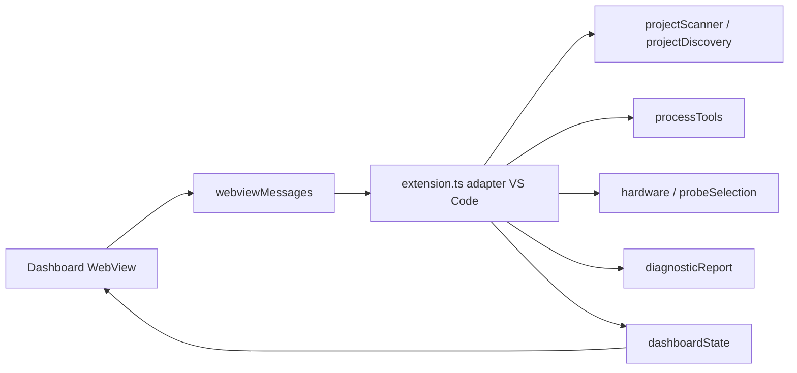

# Architecture de QC1

## Couches

`src/extension.ts` est l'adaptateur principal avec des responsabilités encore larges : lecture des réglages VS Code, photographie du projet et des outils, routage des commandes, pipeline build/flash/debug, rapports et synchronisation du dashboard. Il s'appuie sur des modules métier pour les opérations qui ont déjà une frontière stable. Le fichier fait environ 2 900 lignes; son extraction doit rester progressive et préserver les pipelines existants.

| Domaine | Modules | Responsabilité |
| --- | --- | --- |
| Activation et orchestration VS Code | `src/extension.ts` | Enregistrement des commandes, configuration, processus, erreurs et synchronisation UI |
| Découverte et analyse | `projectScanner.ts`, `filesystem.ts`, `projectDiscovery.ts`, `projectDiagnostics.ts`, `targetArchitecture.ts` | Parcours borné, preuves de projet, CMake, MCU, cœurs, startup et linker |
| CMake | `cmakeInspection.ts`, `cmakePresets.ts`, `cmakeFileApi.ts`, `coreBuild.ts` | Analyse statique, presets, artefacts précédemment générés et cibles CM7/CM4 |
| Exécution externe | `processTools.ts` | Résolution d'exécutables et processus sans shell avec sorties bornées, timeout et annulation |
| Matériel et probes | `hardware.ts`, `probeSelection.ts` | Arguments OpenOCD/st-flash/Cortex-Debug, inventaire ST-Link, association par projet et masquage des numéros |
| État et contrôleurs | `projectDiscoveryController.ts`, `projectConfiguration.ts`, `recentProjectsController.ts`, `projectArtifacts.ts` | Découverte annulable, écritures ordonnées, récents et inspection non destructive d'artefacts |
| Interface | `src/dashboard/` | État typé, rendu échappé, client statique, styles et contrat de messages |
| Rapports | `diagnosticReport.ts`, `systemInspection.ts`, `extensionInventory.ts` | Rapport versionné et anonymisation des données collectées |
| Moteur F1 intégré | `resources/cmake/` | Projet CMake/Ninja et toolchain ARM intégrés pour STM32F1 |

## Flux de commande

1. Une commande de la palette ou une action du dashboard passe par la liste blanche de `webviewMessages.ts` ou un enregistrement VS Code.
2. `getQc1Status()` prend une photographie du projet actif, de l'architecture, des artefacts et des outils.
3. Les diagnostics bloquants sont affichés avant lancement. Les chemins d'exécution et arguments restent séparés; aucun shell n'est utilisé.
4. Chaque processus retourne code de sortie, stdout, stderr, erreur de lancement, timeout et statut. Une sortie sur stderr seule ne signifie pas échec.
5. Avant flash/debug, QC1 inventorie les ST-Link, résout le choix propre au projet et vérifie la famille de cible. Toute incertitude bloque l'accès au matériel.
6. La sortie et le résultat sont transmis à l'interface, puis au rapport sur demande.

## Séparer projet, MCU, carte et probe

- Le projet actif est choisi dans le gestionnaire de projets. `qc1.projectPath` est unique par fenêtre VS Code.
- Le MCU, la carte suggérée et les cœurs sont déduits de preuves dans les fichiers. Le scanner ne prouve pas quel matériel est branché.
- La sonde est identifiée par son numéro de série et associée au chemin du projet dans `workspaceState`. La clé du chemin est un SHA-256; elle évite de recopier le chemin absolu dans la clé.
- L'inventaire affiche le numéro complet dans la Quick Pick afin de distinguer des probes semblables; l'état et les journaux affichent un suffixe.
- La cible runtime est vérifiée par nom de cible OpenOCD lorsque possible; sans OpenOCD, QC1 s'appuie sur l'ID/champ descriptif renvoyé par `st-info`. Cette vérification confirme une famille, pas la référence exacte du composant ou le modèle de carte.

Le mapping conservé contient au plus 50 associations récentes. Les entrées mal formées sont ignorées. Si la sonde mémorisée est absente, QC1 demande une nouvelle sélection; il n'en choisit pas une autre sans avertissement.

## État et concurrence

La découverte a une génération, une annulation et des résultats obsolètes ignorés. Les scans sont bornés et sans polling. La configuration du projet actif est comparée avant les étapes d'une opération; si elle change, QC1 annule les étapes restantes. Le numéro de sonde choisi pendant le précontrôle est intégré à l'empreinte avant d'exécuter le flash.

L'état de navigation des onglets appartient à la WebView. La sélection de projet et les probes ne sont pas stockées dans les messages du client; la sélection de probe est lue et écrite par l'hôte.

## Principes de sécurité

- Exécution avec `spawn` et `shell: false`; chemins/arguments validés pour CMake, ST-Link et l'argument Tcl OpenOCD.
- Workspace Trust contrôlé avant les commandes externes et la collecte de matériel.
- WebView avec CSP, script statique à nonce, rendu échappé et messages à schéma fermé.
- Rapport et journaux bornés; chemins personnels et secrets connus sont masqués. Les numéros de série ST-Link sont masqués dans la sortie et les lignes de commande.
- Le précontrôle de sélection ne programme, n'efface, ne reset et ne halt pas le MCU.

## Ajouter une capacité

Pour ajouter une famille, ne pas ajouter un simple test de nom au flash. Définir d'abord les preuves de détection, les cœurs et cibles, les scripts startup/linker, les commandes d'outil et les contrôles de compatibilité; ajouter des fixtures sans matériel; puis valider sur une cible représentative. Le scanner peut reconnaître une famille sans que son build ou flash soit pris en charge.

Pour ajouter une board, garder son identification distincte du MCU et du backend de probe. Une board est une hypothèse statique tant qu'aucune méthode runtime fiable ne la confirme.

Pour ajouter une probe, créer son inventaire et sa sélection dans `probeSelection.ts`, garder les numéros confidentiels hors des logs, et établir le routage d'outil avant d'autoriser le flash. Pour un diagnostic, préserver le message brut, ajouter une classification déterministe et tester les erreurs comme les cas réussis.

## Dette technique connue

- `extension.ts` reste le coordinateur monolithique de plusieurs flux; une extraction de `probeSelection`/flash en service injectable serait une prochaine étape.
- La famille est vérifiable, mais QC1 ne lit pas encore un identifiant de silicium complet pour prouver un MCU exact.
- La page Outils mesure la présence et les versions seulement lorsque le collecteur les a exécutées; un chemin configuré n'est pas une preuve de compatibilité matérielle.
- Les workflows CI couvrent plusieurs images, mais cette mission n'a pas d'exécution distante GitHub dans son résultat local.
